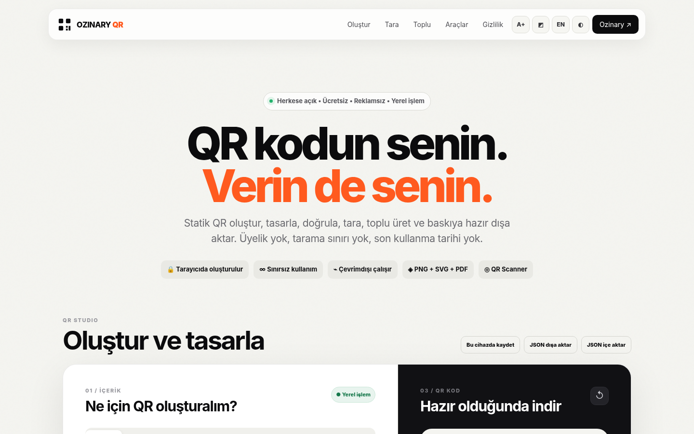
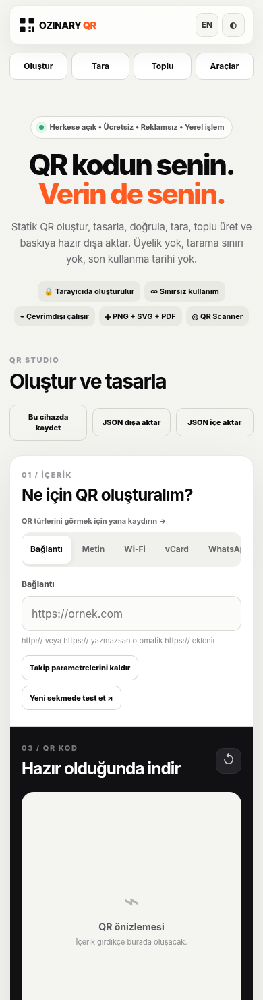

<div align="center">

# Ozinary QR

### QR kodun senin. Verin de senin.

**Ücretsiz · Açık kaynak · Reklamsız · Gizlilik odaklı · Mobil uyumlu**

Statik QR kod oluşturmak, özelleştirmek, okumak, doğrulamak, toplu üretmek ve baskıya hazırlamak için tarayıcı tabanlı araç seti.

[**Kaynak kodu**](https://github.com/ozinary/ozinary-qr) · [**Sorun bildir**](https://github.com/ozinary/ozinary-qr/issues) · [**Ozinary**](https://ozinary.com)

**Sürüm: v3.2** · **Lisans: MIT** · **HTML / CSS / Vanilla JavaScript**

</div>

---

## 📖 Proje hakkında

**Ozinary QR**, kullanıcıların üyelik açmadan veya herhangi bir QR servisine içerik göndermeden **statik QR kod** üretmesini sağlayan, istemci tarafında çalışan açık kaynaklı bir web uygulamasıdır.

Bir web bağlantısını, Wi-Fi bilgilerini, iletişim kartını veya etkinliği QR koda dönüştürebilir; görünümünü özelleştirip PNG, SVG ya da PDF olarak dışa aktarabilirsiniz. QR kod oluşturma, dosya işleme ve toplu üretim işlemleri doğrudan tarayıcıda gerçekleştirilir.

> **Amacımız:** İnternetin basit araçları basit kalmalı. QR oluşturmak için zorunlu üyelik, abonelik veya süreye bağlı bir yönlendirme hizmeti gerekmemeli.

### Neden statik QR?

- İçerik veya bağlantı **doğrudan QR kodunun içine** yazılır.
- Kod, Ozinary QR'ın sunucusuna yönlendirme yapmak zorunda değildir.
- Uygulama kaynaklı **tarama kotası veya QR son kullanma tarihi** bulunmaz.
- Önemli ayrım: QR görseli kendi kendine süre aşımına uğramaz; ancak içindeki web adresi silinirse, alan adı kapanırsa ya da Wi-Fi şifresi değişirse kodun işlevi etkilenebilir.
- Oluşturulan statik QR'ın içeriği sonradan değiştirilemez; yeni içerik için yeni QR oluşturulması gerekir.

## 🖼️ Ekran görüntüleri

<div align="center">
  
  <p><em>Masaüstü görünümü</em></p>
  
  <p><em>Mobil görünüm — v3.2 responsive düzeni</em></p>
</div>

## ✨ Özellikler

### 1. Desteklenen QR içerikleri

| QR türü | Açıklama |
| --- | --- |
| **Bağlantı (URL)** | HTTP/HTTPS bağlantısı; şema yazılmadığında `https://` ekleme |
| **Metin** | Düz metin ve kısa notlar |
| **Wi-Fi** | Ağ adı (SSID), güvenlik türü, şifre ve gizli ağ |
| **vCard** | Ad, soyad, şirket, unvan, iletişim ve adres bilgileri |
| **WhatsApp** | Telefon numarası ve isteğe bağlı hazır mesaj |
| **Konum** | Koordinatlar veya harita bağlantısı |
| **Takvim** | Etkinlik bilgilerini takvim uyumlu içerik olarak kodlama |
| **E-posta** | Alıcı, konu ve mesaj gövdesi |
| **Telefon** | `tel:` bağlantısı |
| **SMS** | Telefon numarası ve hazır SMS metni |

### 2. QR tasarım stüdyosu

- **Hazır temalar:** Klasik, Gece, Okyanus, Orman, Baskı ve Berry.
- **Renkler:** QR rengi, arka plan rengi ve isteğe bağlı degrade.
- **Modül biçimleri:** Kare, yuvarlatılmış, nokta ve elmas.
- **Köşe/göz biçimleri:** Kare, yuvarlatılmış ve dairesel.
- **Hata düzeltme:** `L`, `M`, `Q`, `H`.
- **Sessiz alan (quiet zone):** 4, 6 veya 8 modül; uygulama en az 4 modülü korur.
- **Logo:** Cihazdan PNG/JPEG/WebP/SVG dosyası seçme veya sürükle-bırak; kırpma ve boşluk ayarları.
- **Logo güvenliği:** Logo kullanıldığında hata düzeltme seviyesi `H` olarak ayarlanır. Yine de gerçek telefonla tarama testi yapılmalıdır.
- **Çerçeve ve etiket:** İnce çerçeve, kart, CTA etiketi ve QR altında açıklama.
- **Hazır CTA'lar:** “Menüyü Aç”, “Wi-Fi'a Bağlan”, “Bizi Takip Et”, “Kartviziti Kaydet”.
- **Okunabilirlik kontrolü:** Kontrast, sessiz alan, yoğunluk ve logo gibi faktörler için uyarılar.

### 3. İndirme, paylaşım ve baskı

| Çıktı | Kullanım |
| --- | --- |
| **PNG** | 1024 × 1024, 2048 × 2048 veya 4096 × 4096 px seçeneği |
| **SVG** | Ölçeklenebilir vektörel çıktı; web ve baskı projeleri |
| **PDF** | Baskıya yönelik PDF dışa aktarma |
| **Story kartı** | 1080 × 1920 px dikey sosyal medya görseli |
| **A4 yazdırma** | Sayfa başına 1, 4, 9 veya 16 QR; ayrıca özel satır/sütun |
| **Sticker PDF** | 50 × 50, 70 × 70 veya 90 × 90 mm etiket düzenleri |
| **Paylaş** | Desteklenen cihazlarda işletim sisteminin paylaşım menüsü |

**Baskı notu:** PDF çıktısındaki QR görseli raster tabanlı olabilir; profesyonel vektörel baskı için **SVG** tercih edin. Özel renk, gradyan ve logo kombinasyonlarını baskıdan önce farklı cihazlarla okutun.

### 4. QR tarayıcı ve doğrulama

- Kamera ile QR kod okuma.
- Fotoğraf veya görsel dosyasından QR içeriğini çözümleme.
- Sonucu kopyalama veya oluşturucuya aktarma.
- Oluşturulan QR kodu tekrar okuyarak doğrulama (destekleyen tarayıcılarda).
- Otomatik yeniden okuma mümkün değilse **yapısal kalite kontrolleri**; bu kontrol gerçek tarama başarısını garanti etmez.

> **Tarayıcı uyumluluğu:** Bu sürümde kamera/görsel okuma, tarayıcının yerleşik [`BarcodeDetector`](https://developer.mozilla.org/en-US/docs/Web/API/BarcodeDetector) API'sine bağlıdır. Her tarayıcıda desteklenmeyebilir. Destek yoksa QR **oluşturma** özellikleri çalışmaya devam eder.

### 5. Toplu QR oluşturma

- CSV veya TXT dosyası yükleme; ayrıca verileri doğrudan yapıştırma.
- **Tek seferde en fazla 500 kayıt.**
- PNG, SVG ya da her iki formatta toplu indirme.
- PNG için 512, 1024 veya 2048 px seçenekleri.
- Mevcut QR tasarımını toplu çıktılara uygulama seçeneği.
- Sonuçları **tek ZIP dosyası** olarak indirme.
- CSV içeriği ve ZIP üretimi tarayıcıda işlenir.

### 6. Ek araçlar

- **URL temizleyici:** `utm_*`, `fbclid`, `gclid` ve diğer bazı takip parametrelerini kaldırır.
- **QR boyut hesaplayıcı:** Tarama mesafesine göre yaklaşık fiziksel baskı boyutu önerir; bir garanti veya sertifikasyon değildir.
- **Proje dışa/içe aktarma:** JSON biçiminde proje ayarlarını kaydetme ve geri yükleme.
- **İsteğe bağlı cihaz içi proje kaydı:** Tarayıcıda en fazla 20 proje.
- **Geliştirici araçları:** Ham payload, SVG kaynak kodu, Data URI, PNG Base64 ve HTML embed çıktısı.
- **Erişilebilirlik seçenekleri:** Klavye kullanımı, büyük yazı, yüksek kontrast ve azaltılmış hareket tercihine duyarlı görünüm.
- **Görünüm:** Açık/koyu tema; Türkçe ve İngilizce arayüz altyapısı.
- **PWA / offline:** İlk yüklemeden sonra desteklenen tarayıcılarda çevrimdışı kullanılabilen uygulama kabuğu.
- **Responsive arayüz:** v3.2 ile telefon, tablet ve masaüstü yerleşimi iyileştirildi.

---

## 🚀 Hızlı başlangıç

**Sunucu tarafı bağımlılık yoktur:** PHP, Node.js, veritabanı, API anahtarı veya VPS gerekmez. Güncel bir web tarayıcısı ve dosyaları servis eden herhangi bir statik hosting yeterlidir.

### 1. Kaynak kodunu alın

```bash
git clone https://github.com/ozinary/ozinary-qr.git
cd ozinary-qr
```

Repo henüz GitHub'a yüklenmediyse proje ZIP'ini açıp aynı klasörde çalışabilirsiniz.

### 2. Bilgisayarınızda çalıştırın

Python yüklüyse:

```bash
python3 -m http.server 8080
```

Ardından tarayıcıdan **http://localhost:8080** adresini açın.

Alternatif olarak `index.html` dosyasını doğrudan açabilirsiniz; ancak `file://` üzerinden PWA/Service Worker ve bazı tarayıcı API'leri kısıtlanabilir. Geliştirme ve test için `localhost` kullanılması önerilir.

### 3. cPanel / normal hosting'e yükleyin

Hosting'in dosya yöneticisinde örneğin şu konuma yükleyin:

```text
public_html/
└── qr/
    ├── index.html
    ├── assets/
    ├── vendor/
    ├── icons/
    ├── manifest.webmanifest
    ├── sw.js
    └── ...
```

Önemli: ZIP içindeki **klasörün içeriğini** `public_html/qr/` konumuna koyun; yanlışlıkla `public_html/qr/ozinary-qr/index.html` şeklinde bir iç klasör oluşturmayın.

Bu örnek yapı, siteyi aşağıdaki adreste sunar:

```text
https://ozinary.com/qr/
```

Özel alan adı, alt alan adı, GitHub Pages veya başka statik hosting üzerinde de çalışabilir. Kamera ve PWA özellikleri için genel kullanımda **HTTPS** gereklidir (`localhost` güvenilir geliştirme ortamı istisnasıdır).

### 4. GitHub Pages ile yayımlama (isteğe bağlı)

1. Proje dosyalarını deponun kök dizinine ekleyin.
2. GitHub'da **Settings → Pages** bölümüne gidin.
3. İstediğiniz branch'i ve kök klasörü (`/`) seçerek dağıtımı etkinleştirin.
4. GitHub Pages'in oluşturduğu bağlantıdan projeyi açın.

Uygulama dosyalarında **göreli yollar** kullanıldığı için alt dizin üzerinden yayımlama için de uygundur.

---

## 🧭 Kullanım örnekleri

### Bağlantı için QR

1. **Oluştur → Bağlantı** sekmesine geçin.
2. `https://example.com` gibi bir adres yazın.
3. Önizleme oluştuğunda renk, logo ve çerçeve seçeneklerini düzenleyin.
4. Mümkünse **QR'ı doğrula** seçeneğini kullanın.
5. PNG, SVG veya PDF indirin; dağıtmadan önce gerçek telefonda test edin.

### Wi-Fi için QR

1. **Wi-Fi** sekmesinden ağ adı (SSID), güvenlik türü ve şifreyi girin.
2. İsteğe bağlı **Gizli ağ** ayarını seçin.
3. QR'ı üretip indirin. Tarayan cihazın ve işletim sisteminin Wi-Fi QR biçimini desteklemesi gerekir.

### Toplu üretim örneği

`name,content` sütunlarını içeren UTF-8 bir CSV hazırlayın:

```csv
name,content
website,https://ozinary.com
contact,mailto:hello@example.com
support,https://example.com/help
```

**Toplu** bölümünde yapıştırın veya dosyayı yükleyin; çıktı formatını seçip **ZIP oluştur** düğmesine basın.

> Çok büyük girdiler, logolar veya yüzlerce yüksek çözünürlüklü PNG, cihazın bellek/işlemci sınırlarına takılabilir. Bu durumda daha küçük partiler halinde üretin.

### Basılı materyalde kullanım

- QR çevresindeki **sessiz alanı** koruyun.
- Koyu kod / açık arka plan genellikle daha güvenilirdir.
- SVG'yi tercih edin ve son baskı boyutunda test edin.
- Logo ve yoğun içerik kullanıldığında gerçek okutma testini atlamayın.

---

## 🔐 Gizlilik ve veri işleme

Ozinary QR, **QR üretimi için girilen içeriği bir uygulama sunucusuna göndermeden** çalışacak şekilde tasarlanmıştır.

| İşlem | Nerede gerçekleşir? | Önemli not |
| --- | --- | --- |
| QR oluşturma ve tasarım | Tarayıcıda | Kullanıcı girdileri QR üretimi için sunucuya gönderilmez |
| CSV/TXT işleme ve ZIP hazırlama | Tarayıcıda | Dosyalar uygulama backend'ine yüklenmez |
| Logo işleme | Tarayıcıda | Yerel dosyalar uygulama backend'ine yüklenmez |
| Kamera/görsel QR okuma | Tarayıcıda | Yerleşik `BarcodeDetector` desteği gerekir |
| PNG, SVG, PDF üretimi | Tarayıcıda | Çıktılar cihazda hazırlanır |
| Manuel proje kaydı | Tarayıcı `localStorage` alanında | Yalnızca kullanıcı kaydetmeyi seçerse |
| Otomatik proje geçmişi | Tarayıcı `localStorage` alanında | Varsayılan **kapalıdır**; istenirse açılır |
| Tema/arayüz tercihleri | Tarayıcı yerel depolamasında | QR içeriğinden farklı olan kullanım tercihleri saklanabilir |
| PWA dosyaları | Tarayıcı önbelleğinde | Uygulama dosyaları çevrimdışı kullanıma hazırlanır |
| **Site ikonunu dene** | Hedef web sitesine ağ isteği | **Kullanıcı isterse** `/favicon.ico` talep edilir; CORS nedeniyle başarısız olabilir |

**Şeffaflık notları:**

- Hosting/CDN sağlayıcınız, normal web sunucusu **IP adresi ve erişim logları** tutabilir. “Hiçbir sunucu kaydı yok” iddiasında bulunulmamalıdır.
- Kullanıcı dış bir bağlantıya tıkladığında veya QR'ın hedefini açtığında, **hedef web sitesi** kendi kayıt ve gizlilik politikasına göre işlem yapabilir.
- Uygulama; hesap açma, sunucu tarafı QR geçmişi, kullanıcı bazlı tarama istatistikleri veya üçüncü taraf analitik hizmeti içermez.
- Kullanıcı isteğine bağlı yerel kayıtlar tarayıcının kendi verileridir; farklı cihazlar arasında otomatik eşitlenmez.
- Bu açıklama uygulamanın mevcut kaynak koduna ilişkindir. Kendi dağıtımınıza analitik, reklam veya başka servis eklerseniz ilgili gizlilik açıklamasını güncelleyin.

---

## 🗂️ Proje yapısı

```text
ozinary-qr/
├── index.html                  # Tek sayfa uygulama arayüzü
├── assets/
│   ├── styles.css              # Responsive tasarım ve temalar
│   └── app.js                  # QR oluşturma, tarama, batch ve export işlemleri
├── vendor/
│   └── qrcode.min.js           # Yerel QRCode.js kütüphanesi
├── icons/
│   ├── icon.svg
│   ├── icon-192.png
│   └── icon-512.png
├── docs/
│   └── screenshots/            # GitHub README ekran görüntüleri
├── manifest.webmanifest        # PWA manifesti
├── sw.js                       # Service Worker / offline önbellek
├── robots.txt
├── OFFLINE-USAGE.txt
├── THIRD-PARTY-LICENSES.txt
├── LICENSE.txt                 # MIT lisansı
└── README.md
```

### Teknoloji yığını

| Katman | Teknoloji |
| --- | --- |
| Arayüz | HTML5, CSS3, Vanilla JavaScript |
| QR üretimi | Projeye dahil edilmiş QRCode.js |
| Görsel üretim | Canvas API, SVG |
| QR tarama | Tarayıcının `BarcodeDetector` API'si |
| Kamera | `getUserMedia` |
| Proje saklama | İsteğe bağlı `localStorage` |
| PWA | Web App Manifest + Service Worker |
| Paketleme | Tarayıcı tarafında ZIP/PDF çıktısı üretimi |
| Sunucu | **Gerekmez**; statik dosya sunucusu yeterlidir |

Üçüncü taraf bir QR üretim API'si ya da harici JS/CSS CDN'i kullanılması zorunlu değildir; gerekli QR kütüphanesi depoda yerel olarak bulunmaktadır.

---

## ⚙️ Özelleştirme ve dağıtım

| Değiştirmek istediğiniz şey | Düzenlenecek yer |
| --- | --- |
| Site adı, sayfa metinleri ve GitHub bağlantısı | `index.html` |
| Renkler, düzen, mobil kırılım noktaları | `assets/styles.css` |
| QR türleri, doğrulama, export ve araçlar | `assets/app.js` |
| PWA adı, açıklaması ve ikonları | `manifest.webmanifest`, `icons/` |
| PWA önbellek sürümü | `sw.js` içindeki `CACHE` sabiti |
| Tarayıcı/favicon davranışı | `assets/app.js` içindeki ilgili fonksiyonlar |

**Güncelleme ipucu:** Uygulama dosyalarını yeniledikten sonra eski sürüm gösteriliyorsa `sw.js` içindeki önbellek sürümünü artırın; ardından sayfayı yenileyin. Gerekirse tarayıcının site verilerini temizleyin. Bu işlem isteğe bağlı cihaz içi projeleri de silebilir; önce JSON dışa aktarmayı önerin.

**Statik hosting notu:** `sw.js`, `manifest.webmanifest` ve tüm göreli dosya yolları birlikte yüklenmelidir. Sadece `index.html` dosyasını sunucuya koymak yeterli değildir.

---

## 📱 Tarayıcı uyumluluğu ve sınırlamalar

- Temel QR üretimi modern masaüstü ve mobil tarayıcılar için tasarlanmıştır.
- QR tarayıcısı ve otomatik yeniden okuma **`BarcodeDetector`** desteğine bağlıdır.
- Kamera, güvenli bağlam (**HTTPS / localhost**) ve kullanıcı izni ister.
- PWA kurulumu tarayıcı/işletim sistemi davranışına bağlıdır; her platformda aynı yükleme arayüzü görülmeyebilir.
- Doğrudan `file://` üzerinden açıldığında Service Worker kullanılamaz.
- Paylaş butonu cihazda `navigator.share` desteği varsa sistem paylaşımını açar; yoksa indirmeye başvurabilir.
- Bazı cihazlarda çok büyük PNG veya 500 kayıtlık toplu işlem bellek sınırına ulaşabilir.
- Renk/gradient/logo tercihlerinin tüm telefon kameralarda sorunsuz okunacağı **garanti edilemez**.
- Uygulama statik QR üretir: dinamik yönlendirme, QR hedefini değiştirme, tarama analitiği veya bulut senkronizasyonu sağlamaz.
- Bu proje erişilebilirlik seçenekleri içerir ancak bağımsız bir **WCAG uygunluk sertifikası** iddiasında bulunmaz.

## ⌨️ Klavye kısayolları

| Kısayol | İşlem |
| --- | --- |
| `Ctrl + S` / `⌘ + S` | PNG dışa aktarma |
| `Ctrl + Shift + S` / `⌘ + Shift + S` | SVG dışa aktarma |

Kısayollar, uygulamanın açık olduğu tarayıcı sekmesinde çalışır.

---

## 🧪 Sürüm doğrulama kontrol listesi

Değişiklik yaptıktan sonra en az aşağıdaki senaryoları deneyin:

- [ ] URL, metin, Wi-Fi ve vCard QR üretimi
- [ ] Varsayılan ve logolu QR'ı gerçek telefonla okutma
- [ ] PNG, SVG ve PDF dosyalarını açıp kontrol etme
- [ ] 50/70/90 mm sticker ve A4 çıktılarının baskı önizlemesi
- [ ] CSV/TXT ile çoklu QR → ZIP oluşturma
- [ ] JSON içe/dışa aktarma ve yerel kayıt silme
- [ ] GitHub bağlantısı ve açık kaynak bölümü
- [ ] Mobil ekranlarda yatay taşma ve kullanılabilirlik (320–430 px)
- [ ] Tablet ve masaüstü düzenleri
- [ ] HTTPS üzerinde PWA kurulumu ve yeniden açıldığında offline kullanım
- [ ] Desteklenen/desteklenmeyen tarayıcılarda scanner davranışı

---

## 🤝 Katkıda bulunma

Katkılara açığız. Hata bulduysanız, erişilebilirlik sorunu yaşıyorsanız veya yeni bir özellik önermek istiyorsanız:

1. Önce [Issues](https://github.com/ozinary/ozinary-qr/issues) sayfasında benzer bir kayıt bulunup bulunmadığını kontrol edin.
2. Yeni konu açarken kullanılan tarayıcıyı, işletim sistemini, sorunu yeniden üretme adımlarını ve mümkünse ekran görüntüsünü ekleyin.
3. Kod katkısı için depoyu fork'layın, ayrı bir dal oluşturun ve anlaşılır bir açıklama ile Pull Request gönderin.
4. Gizlilik odaklı, yerel çalışan ve bağımlılığı düşük mimariyi mümkün olduğunca koruyun.
5. Başka bir kütüphane eklerseniz lisans ve telif bildirimini de depoya dahil edin.

```bash
git checkout -b feature/ozellik-adi
# Değişikliklerinizi yapın
git add .
git commit -m "feat: özellik açıklaması"
git push origin feature/ozellik-adi
```

**Güvenlik:** Hassas bir zafiyet keşfettiyseniz, ayrıntıları herkese açık bir Issue içinde paylaşmadan önce depo yöneticileriyle uygun bir özel kanaldan iletişim kurun. Uygulamanın tıbbi, finansal veya güvenlik-kritik süreçler için ayrıca doğrulama olmadan kullanılmasını önermiyoruz.

## 📝 Sürüm notları

### v3.2 — Responsive iyileştirmeler · Ekim 2026

- Mobil/tablet yerleşiminin yeniden düzenlenmesi.
- Mobil QR türü sekmelerinin yatay kaydırılabilir hale gelmesi.
- Önizleme ve tasarım alanlarının küçük ekranlara uyarlanması.
- Form, buton, navigasyon ve panel taşma sorunlarının giderilmesi.
- GitHub bağlantısının [`ozinary/ozinary-qr`](https://github.com/ozinary/ozinary-qr) olarak güncellenmesi.
- PWA önbellek sürümünün yenilenmesi.

### v3.1 — Açık kaynak bölümü

- Açık kaynak bölümünde birden çok indirme/kurulum butonu yerine tek GitHub bağlantısı.
- v3 QR Toolkit özellik setinin korunması.

### v3 — QR Toolkit

- QR oluşturma/tarama/doğrulama, toplu ZIP, baskı, projeler, geliştirici araçları ve çevrimdışı kullanım.

---

## 📄 Lisans ve üçüncü taraf yazılımlar

Projenin uygulama kodu **MIT Lisansı** altında dağıtılır. Lisans metni için [LICENSE.txt](LICENSE.txt) dosyasına bakın.

QR üretiminde projeye dahil edilen **QRCode.js** kütüphanesi de MIT lisansıyla sunulur. Telif bilgileri ve üçüncü taraf lisans bildirimleri [THIRD-PARTY-LICENSES.txt](THIRD-PARTY-LICENSES.txt) dosyasında yer alır. Projeyi yeniden dağıtırken ilgili lisans bildirimlerini koruyun.

## 💬 Sık sorulan sorular

<details>
<summary><strong>QR kodlar gerçekten ücretsiz ve sınırsız mı?</strong></summary>

Evet. Bu uygulama QR oluşturma veya tarama için kullanıcıya hesap, abonelik ya da uygulama kaynaklı tarama kotası koymaz. Çok yoğun toplu üretimde cihaz kaynakları doğal sınır oluşturabilir.

</details>

<details>
<summary><strong>QR kodum Ozinary kapansa da çalışır mı?</strong></summary>

Statik QR, doğrudan içine kodlanan bilgiye dayanır. Hedef web adresi veya kodlanan veri geçerli kaldığı sürece Ozinary QR hizmeti olmadan da okutulabilir.

</details>

<details>
<summary><strong>QR'ın yönlendirdiği adresi sonradan değiştirebilir miyim?</strong></summary>

Doğrudan hayır. Statik QR içeriği sabittir. Kendi kontrol ettiğiniz bir yönlendirme URL'sini QR'a yazarsanız bu URL'nin sunucudaki hedefini ayrıca yönetebilirsiniz; bu proje böyle bir yönlendirme servisi sunmaz.

</details>

<details>
<summary><strong>Sunucuda hiçbir kayıt tutulmuyor mu?</strong></summary>

QR oluşturmak için girdiğiniz bilgiler uygulama sunucusuna iletilmez. Bununla birlikte web barındırma sağlayıcısı normal HTTP erişim logları tutabilir ve kullanıcının açtığı harici sitelerin kendi kayıtları olabilir.

</details>

<details>
<summary><strong>VPS veya veritabanı gerekiyor mu?</strong></summary>

Hayır. Standart statik hosting, cPanel veya GitHub Pages yeterlidir.

</details>

---

<div align="center">

**İnternetin basit araçları basit kalmalı.**

Ozinary tarafından geliştirilen, herkesin inceleyebileceği ve kullanabileceği açık kaynaklı bir araç.

[GitHub](https://github.com/ozinary/ozinary-qr) · [Ozinary](https://ozinary.com) · [MIT Lisansı](LICENSE.txt)

© 2026 Ozinary Yazılım Teknolojileri

</div>
